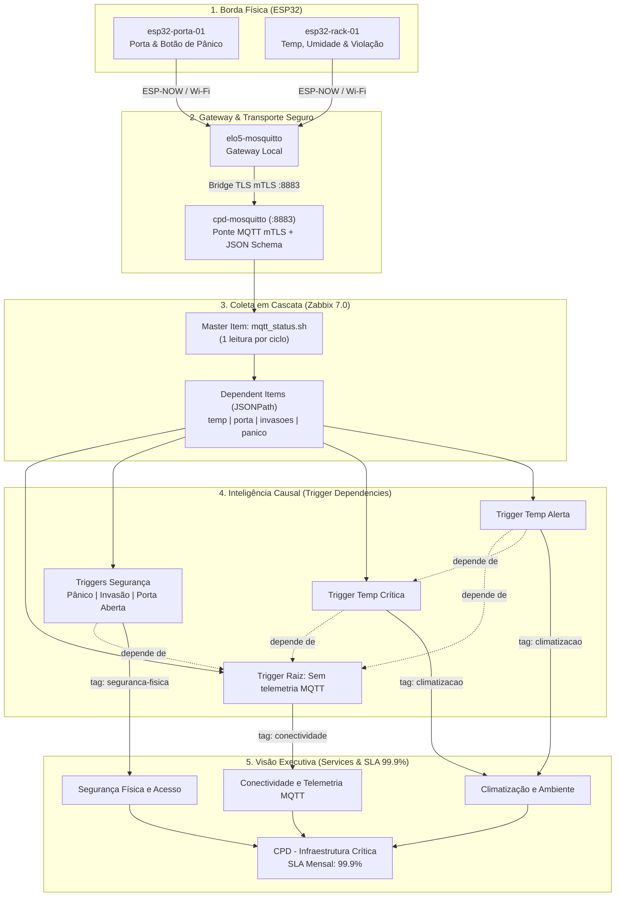

# A Jornada de Engenharia: De Um Único ESP32 à Observabilidade Crítica de CPD

Este documento registra a evolução arquitetural completa do projeto **Elo5System2 / Monitoramento de CPD**, narrando como um protótipo inicial de bancada com um único microcontrolador amadureceu — passo a passo, frente a cada desafio real de operação — até se consolidar como uma plataforma distribuída, criptografada, testada, auditável e provisionada integralmente como código.

---

## Capítulo 1 — O Ponto de Partida: Um Único ESP32 na Bancada

### O Contexto Inicial
Toda grande arquitetura nasce de uma prova de conceito enxuta. No início, o sistema resumia-se a **um único microcontrolador ESP32** concentrando sensores ambientais (temperatura e umidade) e sensores discretos de segurança física (contato magnético de abertura), publicando cargas úteis em JSON para validar a leitura básica de telemetria.

### O Problema que Emergiu
Assim que o protótipo saiu da bancada para a realidade física de um Centro de Processamento de Dados (CPD), ficou evidente uma limitação estrutural: **monitorar o perímetro de acesso da sala** e **monitorar o microclima e a integridade interna de um rack** são domínios fisicamente distantes e com perfis de risco distintos.
* Concentrar tudo em uma única placa exigiria longos lances de cabeamento de baixa tensão sujeitos a ruído eletromagnético.
* Uma falha elétrica ou manutenção no sensor da porta cegaria simultaneamente o monitoramento térmico do rack.
* A arquitetura não escalava caso novos racks fossem incorporados ao ambiente.

---

## Capítulo 2 — A Virada Distribuída: Nós Especializados e Fronteira Criptografada (mTLS)

### A Decisão Arquitetural
A resposta foi **desacoplar a borda física por responsabilidade**, dividindo a coleta entre dois nós autônomos e especializados:
* **`esp32-porta-01` (Perímetro e Acesso):** instalado junto à porta principal do CPD, responsável por monitorar o estado de abertura, o tempo acumulado de porta aberta e o acionamento físico do botão de pânico.
* **`esp32-rack-01` (Microclima e Gabinete):** instalado no interior do rack crítico, responsável por monitorar temperatura, umidade relativa e tentativas de violação física do gabinete.

### Segurança no Transporte (Bridge MQTT sobre mTLS `:8883`)
Com dois nós comunicando-se na borda com o gateway local (`elo5-mosquitto` via ESP-NOW / Wi-Fi isolado), surgiu o próximo requisito crítico: **como transportar essa telemetria até o servidor central de observabilidade sem expor os microcontroladores diretamente à rede corporativa?**

Implementou-se uma fronteira de segurança baseada em **ponte MQTT sobre TLS mútuo (mTLS na porta `8883`)** até o broker central (`cpd-mosquitto`):
* Tanto o broker central quanto o gateway de borda autenticam-se mutuamente por meio de certificados X.509 emitidos por uma Autoridade Certificadora (CA) dedicada.
* O roteamento de mensagens é restrito por ACLs e filtros explícitos de tópico (`elo5/+/status`), garantindo que nenhum dispositivo não autorizado injete telemetria falsa no núcleo.

---

## Capítulo 3 — O Contrato de Dados e a Coleta em Cascata Sem Sobrecarga

### O Desafio de Integridade e Eficiência
À medida que os payloads JSON cresceram em riqueza de atributos (incluindo contadores de invasão, IP de origem, timestamps e estados booleanos), dois riscos operacionais precisavam ser neutralizados:
1. **Deriva de esquema ou payloads corrompidos** capazes de quebrar scripts de ingestão ou gerar leituras absurdas.
2. **Tempestade de conexões no broker MQTT** caso o servidor de monitoramento abrisse uma conexão distinta para consultar cada métrica individualmente a cada minuto.

### As Duas Camadas de Solução
1. **Contrato Estrito via JSON Schema:** formalizou-se um contrato rigoroso validando tipos de dados, campos obrigatórios, enumerações de estado permitidas, formato de endereço IP e faixas físicas plausíveis de temperatura e umidade antes de qualquer processamento.
2. **Padrão Master Item + Dependent Items no [Zabbix 7.0](https://www.zabbix.com/documentation/7.0/en/manual/config/items/itemtypes/dependent_items):** em vez de realizar dezenas de consultas isoladas, o Zabbix executa **um único Master Item (`mqtt_status.sh`)** por nó a cada ciclo de coleta, capturando o JSON bruto completo. A partir dessa única leitura em memória, múltiplos **Dependent Items** extraem suas métricas via expressões **JSONPath** — zerando o overhead de rede no broker e garantindo atomicidade temporal entre todas as métricas de um mesmo ciclo.

---

## Capítulo 4 — Infraestrutura como Código Idempotente (`configurar_zabbix.py`)

### O Fim da Configuração Manual ("ClickOps")
Configurar grupos de hosts, macros de limiar (`{$TEMP.ALERTA}`, `{$TEMP.CRITICO}`, `{$ESP32.SEM_DADOS}`), itens mestre, itens dependentes e triggers manualmente pela interface web funciona apenas na primeira instalação. Em ambientes críticos, a configuração manual gera desvio de ambiente (*configuration drift*), erros humanos e incapacidade de recuperação rápida após desastres.

### Provisionamento Declarativo via API JSON-RPC
Toda a camada de monitoramento foi codificada no provisionador **`configurar_zabbix.py`**, projetado sob o princípio estrito da **idempotência**:
* A cada execução, o script autentica-se na API JSON-RPC do Zabbix 7.0, inspeciona o estado atual do servidor e compara com o estado desejado declarado em código.
* Recursos ausentes são criados; recursos existentes têm apenas seus atributos mutáveis atualizados (respeitando restrições internas da API do Zabbix, como a imutabilidade de `hostid` em `item.update` e a política de retenção `trends=0` para itens não numéricos).
* Ao final da execução, o próprio script exporta os templates consolidados em formato YAML, mantendo o repositório sincronizado com o estado real da infraestrutura.

---

## Capítulo 5 — Blindagem Contra Regressões: Testes, Linting e CI/CD

### Automação Exige Verificação Contínua
Uma infraestrutura automatizada sem rede de segurança pode propagar uma falha de sintaxe ou de contrato para toda a operação em segundos. Para elevar o projeto ao padrão de engenharia de produção, construiu-se uma esteira completa de qualidade:
* **Suíte de Testes Unitários Determinísticos (`pytest`):** cobertura completa dos contratos JSON Schema (testando payloads válidos, campos ausentes, tipos inválidos, campos extras proibidos e valores fora de faixa), normalização defensiva de URLs (`_normalize_zabbix_url`) e simulação fiel da API JSON-RPC do Zabbix via mocks — permitindo validar toda a lógica de `upsert` em frações de segundo, mesmo sem containers em execução.
* **Testes Ponta a Ponta (E2E) com Restauração Garantida:** validação integrada publicando eventos reais de alarme no broker MQTT e verificando o disparo efetivo no Zabbix, protegida por blocos `try...finally` que garantem a restauração automática do estado baseline mesmo em caso de falha intermediária.
* **Análise Estática e CI no [GitHub Actions](https://github.com/CrisisUp/monitoramento-cpd/actions):** verificação automática de estilo, tipagem e boas práticas com [Ruff](https://docs.astral.sh/ruff/) e execução obrigatória de toda a suíte de testes a cada `push` ou `pull request` na branch `main`.

---

## Capítulo 6 — Inteligência Causal: Silenciando Tempestades de Alertas

### O Problema do Ruído Operacional
Em sistemas de monitoramento planos, quando um nó perde energia ou sofre queda na conectividade de rede, todas as suas métricas param de chegar simultaneamente. Sem inteligência causal, o operador recebe uma enxurrada de alarmes falsos ou redundantes (alerta de porta, alerta de temperatura, alerta de sensor indisponível), dificultando identificar a verdadeira causa raiz (*root cause*).

### Supressão Hierárquica via `Trigger Dependencies`
Evoluímos o motor de regras do Zabbix 7.0 para raciocinar sobre **causalidade entre eventos**:
* **Nó Raiz de Conectividade:** a trigger **`Sem telemetria MQTT há {$ESP32.SEM_DADOS}`** é provisionada primeiro e definida como dependência superior de todas as triggers operacionais daquele nó (botão de pânico, invasão física, porta aberta e temperatura). Se o link cair, apenas o alarme de conectividade é disparado — suprimindo automaticamente os alarmes filhos.
* **Escalonamento Térmico Inteligente:** no monitoramento climático do rack, a trigger preventiva (**Temperatura em alerta**) depende também da trigger severa (**Temperatura crítica**). Caso a temperatura suba abruptamente acima do limiar crítico, o sistema suprime o aviso preventivo e notifica diretamente a criticidade máxima.

---

## Capítulo 7 — Visão Executiva: Árvore de Services e SLA de 99.9%

### De Eventos Técnicos a Governança de Disponibilidade
O capítulo final da jornada conectou a telemetria de baixo nível aos indicadores executivos de disponibilidade do CPD. Em vez de exigir que gestores interpretem dezenas de triggers técnicas isoladas, o `configurar_zabbix.py` passou a rotular cada trigger com **tags semânticas de domínio** (`climatizacao`, `seguranca-fisica` e `conectividade`) e a construir automaticamente a árvore de **Services** no Zabbix 7.0:

```text
CPD - Infraestrutura Crítica (SLA Mensal: 99.9%)
├── Climatização e Ambiente
├── Segurança Física e Acesso
└── Conectividade e Telemetria MQTT
```

### Apuração Mensal de Disponibilidade (SLA)
Acoplado ao serviço raiz **`CPD - Infraestrutura Crítica`**, o provisionador configura um contrato formal de **SLA mensal de 99.9%** alinhado ao fuso horário operacional (`America/Sao_Paulo`). Qualquer incidente crítico de climatização, violação física ou perda de telemetria impacta automaticamente o cálculo de disponibilidade do domínio correspondente e do CPD como um todo — fechando o ciclo completo entre **hardware na borda, segurança criptográfica, automação como código e governança executiva**.

---

## Arquitetura Ponta a Ponta (Visão Consolidada)


